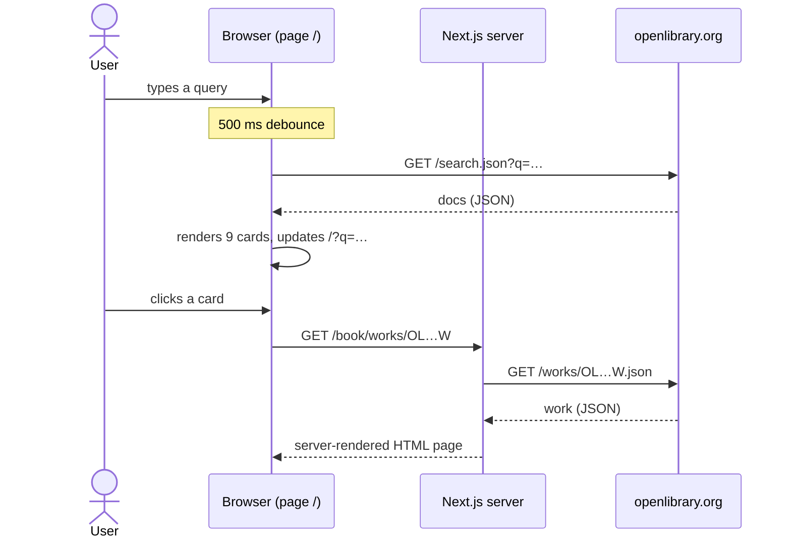

# Open Library Explorer

[Français](README.md) · **English**

A Next.js / React web application that searches books through the public [Open Library](https://openlibrary.org/developers/api) API and shows their details.

## Overview

- Full-text search (the `q` parameter of `https://openlibrary.org/search.json`), sent 500 ms after the last keystroke (debounce). The query is mirrored in the URL (`/?q=…`), so a search can be reloaded or shared.
- Results in a grid of 1, 2 or 3 columns depending on screen width: cover, title, authors, first publication year.
- Results already received are shown 9 at a time ("Charger plus" button, no new API call), with a back-to-top button.
- Loading spinner and error messages ("Aucun résultat trouvé.", "Erreur réseau ou serveur.").
- Book page (`/book/works/<id>`) rendered on the server from `https://openlibrary.org/works/<id>.json`: title, cover, description, subjects and author identifiers.

## Tech stack

Versions resolved in `package-lock.json`:

| Layer | Technology | Version |
|---|---|---|
| Framework | Next.js (App Router, Turbopack) | 16.4.3 |
| UI | React, React DOM | 19.3.1 |
| Styling | Tailwind CSS (PostCSS plugin `@tailwindcss/postcss`) | 4.1.11 |
| Fonts | Geist, Geist Mono (`next/font/google`) | — |
| Tests | Jest, `jest-environment-jsdom`, `babel-jest` | 30.5.2 |
| Tests | `@testing-library/react`, `@testing-library/jest-dom` | 16.3.0, 6.6.3 |
| Code quality | ESLint, `eslint-config-next` (flat config) | 9.39.5, 16.4.3 |
| Runtime | Node.js | 20.9 or later (required by Next.js 16) |

`primeflex`, `@testing-library/user-event`, `@babel/preset-env` and `@babel/preset-react` are declared in `package.json` but not used by any file in the repository.

## Architecture

The application has no back-end of its own, no database and no API key: it calls Open Library directly.

- `src/app/page.js` (Client Component): search state, debounce, `search.json` call from the browser, client-side paging, URL update with `router.replace`. Its content is wrapped in `<Suspense>`, which `useSearchParams()` requires for `next build` prerendering.
- `src/app/book/[...id]/page.js` (async Server Component): a card links to `/book/works/OL…W`; the page reads the identifier from `params.id[1]`, calls `works/<id>.json` on the server and renders `BookDetail`, or "Book not found" on failure.
- `src/components/`: `SearchBar` (controlled input with an `aria-label`), `BookCard` (card and link to the book page, `-M.jpg` cover in an ``), `BookDetail` (`-L.jpg` cover through `next/image`, host allowed in `next.config.mjs`).



## Repository layout

```text
.
├── src/
│   ├── app/
│   │   ├── layout.js              # root layout, Geist fonts, metadata
│   │   ├── page.js                # search page (Client Component)
│   │   ├── globals.css            # Tailwind CSS 4, light / dark colours following the system
│   │   └── book/[...id]/page.js   # book page (Server Component)
│   ├── components/                # SearchBar.jsx, BookCard.jsx, BookDetail.jsx
│   ├── test/HomePage.test.jsx     # Jest test of the home page
│   └── babel.config.js            # next/babel preset (see "Tests")
├── next.config.mjs                # allowed remote images (covers.openlibrary.org)
├── eslint.config.mjs              # ESLint 9, eslint-config-next flat config
├── jest.config.js, jest.setup.js  # Jest (jsdom, @/ alias to src/)
├── postcss.config.mjs             # @tailwindcss/postcss plugin
├── jsconfig.json                  # @/* alias to src/*
└── .github/dependabot.yml         # weekly npm updates
```

## Prerequisites

- Node.js 20.9 or later and npm (the repository ships a `package-lock.json`). Checked with Node.js 22.23 and npm 10.9.
- Internet access: search and book pages call openlibrary.org, and `next build` downloads the Geist fonts from Google Fonts (the build fails if it cannot reach them).

## Local setup

The commands are the same on Windows (PowerShell) and on Linux / macOS.

```bash
git clone https://github.com/rachedchakchouk/open-library-explorer.git
cd open-library-explorer
npm ci
npm run dev
```

Open http://localhost:3000. If port 3000 is taken, Next.js uses the next one (3001…) and says so in the console.

Production build, also served on http://localhost:3000:

```bash
npm run build
npm start
```

| Script | Command | Purpose |
|---|---|---|
| `npm run dev` | `next dev --turbopack` | development server |
| `npm run build` | `next build` | production build |
| `npm start` | `next start` | serves the production build |
| `npm run lint` | `eslint .` | ESLint analysis |
| `npm test` | `jest` | Jest tests |

## Configuration

No environment variable is read and no key is needed: the Open Library URLs are written in the code. `.env*` files are ignored by Git. `next.config.mjs` only allows `https://covers.openlibrary.org` as a remote image source for `next/image`.

## API

The application exposes no API of its own; it consumes Open Library's:

| Call | From | Purpose |
|---|---|---|
| `GET https://openlibrary.org/search.json?q=<query>` | browser (`src/app/page.js`) | search results (`docs`) |
| `GET https://openlibrary.org/works/<id>.json` | Next.js server (`src/app/book/[...id]/page.js`) | details of a work |
| `https://covers.openlibrary.org/b/id/<cover_id>-M.jpg` and `-L.jpg` | `BookCard`, `BookDetail` | covers |

Application pages: `/` (statically prerendered) and `/book/[...id]` (rendered on demand).

## Tests

`npm test` runs Jest (jsdom environment; `jest.setup.js` loads `@testing-library/jest-dom`). The only test, `src/test/HomePage.test.jsx`, renders the home page with a mocked `next/navigation` and checks that the heading is present.

**The test currently fails**, for two reasons that lie in the test setup, not in the application code:

- the Babel configuration lives in `src/babel.config.js`, which `babel-jest` does not find for `jest.setup.js` at the root: Jest stops with "Must use import to load ES Module";
- when pointed to that file, rendering loops ("Maximum update depth exceeded"): the mocked `useRouter()` returns a new object on every render, and `router` is a dependency of the search effect.

`npm run lint` reports no errors; warnings remain for `react-hooks/set-state-in-effect` (rule deliberately downgraded to a warning in `eslint.config.mjs`) and `@next/next/no-img-element` (cover `` tags). No CI runs these commands.

## Build, CI and deployment

- `npm run build` produces a Turbopack build: `/` is prerendered, `/book/[...id]` is rendered on the server for each request.
- The repository contains no GitHub Actions workflow and no hosting configuration.
- Dependabot (`.github/dependabot.yml`): npm ecosystem, every Monday at 06:00 (Africa/Tunis), at most 5 open PRs, commit prefix `deps`, label `dépendances`. Groups: `securite` (security fixes), `next` (`next`, `eslint-config-next`, `react`, `react-dom`) and `mineures-et-correctifs` (minor and patch updates). Major updates of those four packages are ignored and done by hand.

## Known issues

- Books without a cover: `BookCard.jsx` and `BookDetail.jsx` use a placeholder image hosted by Wikimedia (`…/480px-No_image_available.svg.png`) that Wikimedia currently rejects (error 400: thumbnail size not allowed). No image is therefore shown in place of the cover.
- The book page shows authors as Open Library identifiers (`OL…A`), not names.
- The interface mixes French (search page) and English (search field, book page); the page declares `<html lang="en">`.
- The Jest test fails (see "Tests").

## Author

**Rached Chakchouk** — Full Stack Software Engineer (Java / Spring Boot / Angular)
[LinkedIn](https://www.linkedin.com/in/rached-chakchouk) · [Portfolio](https://rached-chakchouk.vercel.app)
