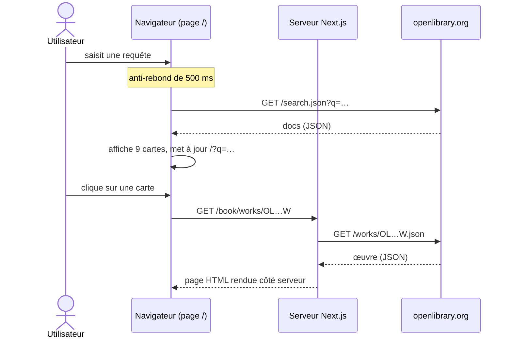

# Open Library Explorer

**Français** · [English](README.en.md)

Application web Next.js / React qui recherche des livres dans l'API publique d'[Open Library](https://openlibrary.org/developers/api) et affiche leur fiche.

## Aperçu

- Recherche plein texte (paramètre `q` de `https://openlibrary.org/search.json`), lancée 500 ms après la dernière frappe (anti-rebond). La requête est reportée dans l'adresse (`/?q=…`) : une recherche peut être rechargée ou partagée.
- Résultats en grille de 1, 2 ou 3 colonnes selon la largeur de l'écran : couverture, titre, auteurs, année de première publication.
- Affichage par tranches de 9 parmi les résultats déjà reçus (bouton « Charger plus », sans nouvel appel à l'API) et bouton de retour en haut de page.
- Indicateur de chargement et messages d'erreur (« Aucun résultat trouvé. », « Erreur réseau ou serveur. »).
- Fiche d'un livre (`/book/works/<id>`) rendue côté serveur à partir de `https://openlibrary.org/works/<id>.json` : titre, couverture, description, sujets et identifiants des auteurs.

## Stack technique

Versions résolues dans `package-lock.json` :

| Couche | Technologie | Version |
|---|---|---|
| Framework | Next.js (App Router, Turbopack) | 16.4.3 |
| Interface | React, React DOM | 19.3.1 |
| Styles | Tailwind CSS (plugin PostCSS `@tailwindcss/postcss`) | 4.1.11 |
| Polices | Geist, Geist Mono (`next/font/google`) | — |
| Tests | Jest, `jest-environment-jsdom`, `babel-jest` | 30.5.2 |
| Tests | `@testing-library/react`, `@testing-library/jest-dom` | 16.3.0, 6.6.3 |
| Qualité | ESLint, `eslint-config-next` (configuration « flat ») | 9.39.5, 16.4.3 |
| Exécution | Node.js | 20.9 ou plus (exigé par Next.js 16) |

`primeflex`, `@testing-library/user-event`, `@babel/preset-env` et `@babel/preset-react` sont déclarés dans `package.json` mais ne sont utilisés par aucun fichier du dépôt.

## Architecture

L'application n'a ni back-end propre, ni base de données, ni clé d'API : elle appelle directement Open Library.

- `src/app/page.js` (Client Component) : état de la recherche, anti-rebond, appel de `search.json` depuis le navigateur, pagination locale, mise à jour de l'adresse avec `router.replace`. Le contenu est enveloppé dans `<Suspense>`, que `useSearchParams()` exige pour le prérendu de `next build`.
- `src/app/book/[...id]/page.js` (Server Component asynchrone) : le lien d'une carte mène à `/book/works/OL…W` ; la page lit l'identifiant dans `params.id[1]`, appelle `works/<id>.json` côté serveur et affiche `BookDetail`, ou « Book not found » en cas d'échec.
- `src/components/` : `SearchBar` (champ contrôlé, avec `aria-label`), `BookCard` (carte et lien vers la fiche, couverture `-M.jpg` en ``), `BookDetail` (couverture `-L.jpg` via `next/image`, domaine autorisé dans `next.config.mjs`).



## Structure du dépôt

```text
.
├── src/
│   ├── app/
│   │   ├── layout.js              # mise en page racine, polices Geist, métadonnées
│   │   ├── page.js                # page de recherche (Client Component)
│   │   ├── globals.css            # Tailwind CSS 4, couleurs claires / sombres selon le système
│   │   └── book/[...id]/page.js   # fiche d'un livre (Server Component)
│   ├── components/                # SearchBar.jsx, BookCard.jsx, BookDetail.jsx
│   ├── test/HomePage.test.jsx     # test Jest de la page d'accueil
│   └── babel.config.js            # preset next/babel (voir « Tests »)
├── next.config.mjs                # images distantes autorisées (covers.openlibrary.org)
├── eslint.config.mjs              # ESLint 9, configuration flat de eslint-config-next
├── jest.config.js, jest.setup.js  # Jest (jsdom, alias @/ vers src/)
├── postcss.config.mjs             # plugin @tailwindcss/postcss
├── jsconfig.json                  # alias @/* vers src/*
└── .github/dependabot.yml         # mises à jour npm hebdomadaires
```

## Prérequis

- Node.js 20.9 ou plus récent et npm (le dépôt fournit un `package-lock.json`). Vérifié avec Node.js 22.23 et npm 10.9.
- Un accès à Internet : la recherche et les fiches interrogent openlibrary.org, et `next build` télécharge les polices Geist depuis Google Fonts (le build échoue s'il ne peut pas les joindre).

## Installation et lancement en local

Les commandes sont identiques sous Windows (PowerShell) et sous Linux / macOS.

```bash
git clone https://github.com/rachedchakchouk/open-library-explorer.git
cd open-library-explorer
npm ci
npm run dev
```

Ouvrez http://localhost:3000. Si le port 3000 est occupé, Next.js prend le suivant (3001…) et l'indique dans la console.

Version de production en local, servie elle aussi sur http://localhost:3000 :

```bash
npm run build
npm start
```

| Script | Commande | Rôle |
|---|---|---|
| `npm run dev` | `next dev --turbopack` | serveur de développement |
| `npm run build` | `next build` | build de production |
| `npm start` | `next start` | sert le build de production |
| `npm run lint` | `eslint .` | analyse ESLint |
| `npm test` | `jest` | tests Jest |

## Configuration

Aucune variable d'environnement n'est lue et aucune clé n'est nécessaire : les adresses d'Open Library sont écrites dans le code. Les fichiers `.env*` sont ignorés par Git. `next.config.mjs` n'autorise que `https://covers.openlibrary.org` comme source d'images distantes pour `next/image`.

## API

L'application n'expose pas d'API ; elle consomme celle d'Open Library :

| Appel | Depuis | Usage |
|---|---|---|
| `GET https://openlibrary.org/search.json?q=<requête>` | navigateur (`src/app/page.js`) | résultats de recherche (`docs`) |
| `GET https://openlibrary.org/works/<id>.json` | serveur Next.js (`src/app/book/[...id]/page.js`) | fiche d'une œuvre |
| `https://covers.openlibrary.org/b/id/<cover_id>-M.jpg` et `-L.jpg` | `BookCard`, `BookDetail` | couvertures |

Pages de l'application : `/` (prérendue en statique) et `/book/[...id]` (rendue à la demande).

## Tests

`npm test` lance Jest (environnement jsdom ; `jest.setup.js` charge `@testing-library/jest-dom`). L'unique test, `src/test/HomePage.test.jsx`, rend la page d'accueil avec `next/navigation` simulé et vérifie la présence du titre.

**Le test échoue actuellement**, pour deux raisons qui tiennent à la configuration de test et non au code de l'application :

- la configuration Babel se trouve dans `src/babel.config.js`, que `babel-jest` ne trouve pas pour `jest.setup.js` à la racine : Jest s'arrête sur « Must use import to load ES Module » ;
- en lui indiquant ce fichier, le rendu boucle (« Maximum update depth exceeded ») : le `useRouter()` simulé renvoie un nouvel objet à chaque rendu, or `router` fait partie des dépendances de l'effet de recherche.

`npm run lint` ne signale aucune erreur ; il reste des avertissements `react-hooks/set-state-in-effect` (règle volontairement passée en avertissement dans `eslint.config.mjs`) et `@next/next/no-img-element` (balises `` des couvertures). Aucune CI n'exécute ces commandes.

## Build, CI et déploiement

- `npm run build` produit un build Turbopack : `/` est prérendue, `/book/[...id]` est rendue côté serveur à chaque requête.
- Le dépôt ne contient aucun workflow GitHub Actions ni configuration d'hébergement.
- Dependabot (`.github/dependabot.yml`) : écosystème npm, chaque lundi à 06:00 (Africa/Tunis), 5 PR ouvertes au plus, préfixe de commit `deps`, label `dépendances`. Groupes : `securite` (correctifs de sécurité), `next` (`next`, `eslint-config-next`, `react`, `react-dom`) et `mineures-et-correctifs`. Les montées de version majeures de ces quatre paquets sont ignorées et se font à la main.

## Limites connues

- Livres sans couverture : `BookCard.jsx` et `BookDetail.jsx` utilisent une image de remplacement hébergée par Wikimedia (`…/480px-No_image_available.svg.png`) que Wikimedia refuse actuellement (erreur 400 : taille de vignette non autorisée). Aucune image ne s'affiche donc à la place de la couverture.
- La fiche affiche les auteurs sous forme d'identifiants Open Library (`OL…A`) et non de noms.
- L'interface mêle le français (page de recherche) et l'anglais (champ de recherche, fiche) ; la page déclare `<html lang="en">`.
- Le test Jest échoue (voir « Tests »).

## Auteur

**Rached Chakchouk** — ingénieur logiciel Full Stack (Java / Spring Boot / Angular)
[LinkedIn](https://www.linkedin.com/in/rached-chakchouk) · [Portfolio](https://rached-chakchouk.vercel.app)
